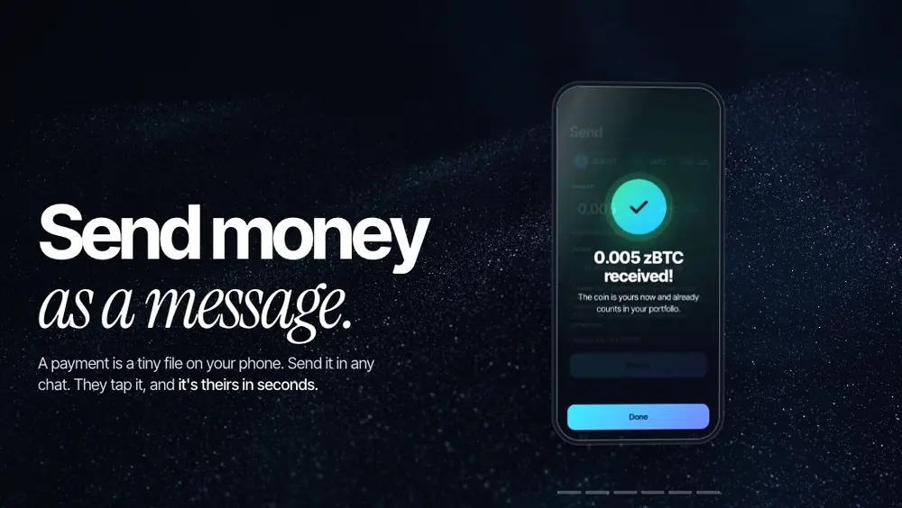

<div align="center">


# ZCrypt

**Send money as a message.**

A payment is a tiny file. Send it in any chat. They tap it, and it's theirs in seconds.

[Website](https://zcrypt.network) · [Get the wallet](https://zcrypt.network/wallet.html) · [Get ZCRYPT](https://zcrypt.network/get-zcrypt.html) · [Explorer](https://explorer.zcrypt.network) · [Whitepaper](whitepaper/whitepaper.pdf) · [Docs](https://zcrypt.network/docs.html)

[](https://github.com/echelonlabsresearch/ZCrypt/actions/workflows/ci.yml?query=branch%3Amainnet) [](https://github.com/echelonlabsresearch/ZCrypt/releases/latest) [](LICENSE)

<a href="https://zcrypt.network"></a>

<sub>Wallet screens with sample data, recorded from <a href="https://zcrypt.network">zcrypt.network</a>.</sub>

</div>

## What is ZCrypt

ZCrypt is private money you can send like a message.

It is its own blockchain. The coin is called ZCRYPT and there will only ever be 21 million of them. When you pay someone, nobody else can see who paid, who got paid, which coin it was or how much. The network still checks every payment and throws out anything that breaks the rules.

You can pay to an address like on any other chain. You can also turn a payment into a small file and send it over WhatsApp, email or AirDrop. Whoever opens the file first gets the money. They don't need an address and they don't need to own any ZCRYPT first. Think of it as handing someone cash.

It also works for other coins. You can bring Bitcoin in as zBTC, create your own coin with a ticker and a supply cap, and swap any coin for any other coin directly on the chain, with no exchange in the middle. All of them live in the same pool, so all of them get the same privacy.

## Under the hood

<table>
<tr><td width="190"><b>One shielded pool</b></td><td>Every coin of every asset sits in one pool. To spend, you prove you own a coin in the pool without saying which one. Your payment hides among every coin ever made on the chain.</td></tr>
<tr><td><b>STARK proofs</b></td><td>Each payment carries a STARK, built with Plonky3 over the BabyBear field with Poseidon2 hashing. No trusted setup and no elliptic curves. Your own device makes the proof, so your keys and amounts never leave it.</td></tr>
<tr><td><b>Quantum resistant</b></td><td>STARKs rely only on hash functions. Payment notes are encrypted with ML-KEM and coin issuers sign with ML-DSA, both NIST post-quantum standards. Block signing (CometBFT) and the Bitcoin side still use today's signatures. Breaking those would not let anyone forge a coin.</td></tr>
<tr><td><b>Consensus</b></td><td>CometBFT proof of stake with one second blocks. The chain logic is a native Rust state machine behind ABCI. There is no smart contract VM to exploit.</td></tr>
<tr><td><b>Bitcoin</b></td><td>The chain runs a Bitcoin light client (SPV) inside consensus. zBTC is minted when validators have checked the Bitcoin deposit proof themselves.</td></tr>
<tr><td><b>Coins and swaps</b></td><td>Creating a coin and swapping two coins are built-in transaction types. A swap is two escrows locked under one secret: both sides settle, or both get refunded.</td></tr>
<tr><td><b>Rules you can read</b></td><td>Every transaction type has a short bytecode program. The one for a payment is 7 instructions. The program and the STARK circuit are tested against each other, and the <a href="https://explorer.zcrypt.network">explorer</a> replays the program for every transaction.</td></tr>
<tr><td><b>Machine-checked math</b></td><td>The rule that a payment can never create money is proved in Lean 4, including that the field arithmetic cannot wrap around. See <a href="formal/README.md">formal/README.md</a> for exactly what is and isn't covered.</td></tr>
</table>

What an outside observer can and cannot see is in [privacy.md](privacy.md). The assumptions and known limits are in [security.md](security.md).

## Get the wallet

Download it for [macOS, Windows or Linux](https://github.com/echelonlabsresearch/ZCrypt/releases/latest), or for [iPhone](https://apps.apple.com/app/id6826877444). It connects to the public node out of the box. Then see [how to get ZCRYPT](https://zcrypt.network/get-zcrypt.html).

## For developers

### The live network

| | |
|---|---|
| Chain id | `zcrypt-1` |
| RPC | <https://rpc.zcrypt.network> |
| Explorer | <https://explorer.zcrypt.network> |

### What's in the repo

| Folder | What it holds |
|---|---|
| [`impl/shield`](impl/shield) | Commitments, the STARK circuit, the commitment tree |
| [`impl/core`](impl/core) | The state machine: every transaction type, staking, assets, the Bitcoin light client |
| [`impl/abci-node`](impl/abci-node) | The node binary that runs under CometBFT |
| [`impl/bridge`](impl/bridge) | Everything that touches Bitcoin: swaps, the bridge daemons, the sale desk |
| [`impl/explorer`](impl/explorer) | The block explorer |
| [`wallet`](wallet) | The desktop and phone wallet (Tauri 2 and React) |
| [`formal`](formal) | The Lean 4 proofs |
| [`chain`](chain) | Docker stacks: a node, a validator, and a 3-node test network |

There are two Cargo projects, `impl/` and `wallet/src-tauri/`, each with its own lockfile. Both pin a Rust nightly in `rust-toolchain.toml`, and rustup installs it for you.

### Build the wallet

You need Node.js 20 or newer and rustup. On Linux you also need `libwebkit2gtk-4.1-dev libgtk-3-dev librsvg2-dev libayatana-appindicator3-dev`.

```bash
cd wallet
npm ci
npm run tauri:dev      # run it (the first build compiles the prover, give it a few minutes)
npm run tauri:build    # make an installer
```

To work on the UI without a chain, `npm run dev` and open <http://localhost:1420/?mock=1>.

### Run the tests

```bash
cd impl
cargo test --locked -p zcrypt-shield -p zcrypt-core --lib
cargo test --locked -p zcrypt-core --tests --examples
cargo test --locked -p zcrypt-abci-node
cargo test --locked -p zcrypt-bridge -p zcrypt-explorer -p zcrypt-cli

cd ../wallet/src-tauri
cargo test --locked
```

The tests make real STARK proofs, so they take minutes. Don't run the whole workspace at once on a small machine: it needs a lot of memory.

### Run a local network

You only need Docker. This starts three validators and a regtest Bitcoin node:

```bash
cd chain
docker compose -f e2e/docker-compose.3node.yml up --build -d
```

The node RPCs are on `localhost:46657`, `46667` and `46677`. Point the wallet at one of them in Settings.

To run every real flow against a fresh network (payments, payment files, coins, staking, Bitcoin swaps in both directions):

```bash
KEEP=0 ./chain/e2e/run-all.sh
```

That takes about 50 minutes.

### Run a node on the live network

```bash
cd chain/validator
cp .env.example .env    # paste the VALIDATOR_KEY line from your wallet first
docker compose up -d
```

This gives you a full node on `zcrypt-1`. It starts producing blocks once you bond stake from the wallet. The full walkthrough is in [chain/README-validator.md](chain/README-validator.md), and [running.md](running.md) covers operating a node.

### Contributing

Work lands on `testnet`, which is a branch and not a separate network. `mainnet` is what ships and only takes pull requests from `testnet`. Open yours against `testnet`. The rest is in [CONTRIBUTING.md](CONTRIBUTING.md).

Found a vulnerability? Email security@zcrypt.network and please don't open a public issue.

## Read next

| If you want | Read |
|---|---|
| The paper | [whitepaper/whitepaper.pdf](whitepaper/whitepaper.pdf) |
| What a stranger can and cannot see | [privacy.md](privacy.md) |
| The cryptographic assumptions, and what is proved | [security.md](security.md) |
| Transactions, fees, staking, issuance, the bridge | [protocol.md](protocol.md) |
| The opcode programs | [vm.md](vm.md) |
| The Lean proofs and their boundary | [formal/README.md](formal/README.md) |
| Run a node or a validator | [running.md](running.md), [chain/README-validator.md](chain/README-validator.md) |
| The explorer | [impl/explorer/README.md](impl/explorer/README.md) |

License: [MIT](LICENSE).
